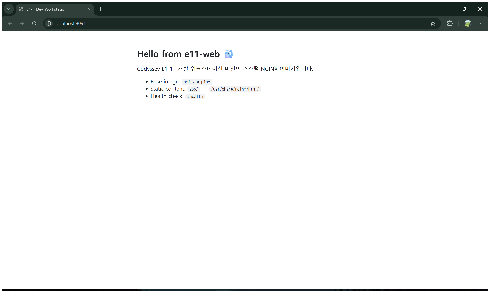

# E1-1 · 내 컴퓨터에 개발자용 '작업실' 꾸미기

> Codyssey 입학 연수 E1-1 미션 수행 보고서
> 터미널 → 권한 → Docker 설치/점검 → 컨테이너 운영 → Dockerfile 커스텀 이미지 → 포트 매핑 → 바인드 마운트 → 볼륨 → Git/GitHub

## 목차
1. [프로젝트 개요](#1-프로젝트-개요)
2. [실행 환경](#2-실행-환경)
3. [수행 체크리스트](#3-수행-체크리스트)
4. [저장소 구조](#4-저장소-구조)
5. [터미널 조작 로그](#5-터미널-조작-로그)
6. [권한 실습](#6-권한-실습)
7. [Docker 설치 및 점검](#7-docker-설치-및-점검)
8. [Docker 기본 운영 & 컨테이너 실습](#8-docker-기본-운영--컨테이너-실습)
9. [Dockerfile 커스텀 이미지](#9-dockerfile-커스텀-이미지)
10. [포트 매핑 접속 증거](#10-포트-매핑-접속-증거)
11. [바인드 마운트 반영](#11-바인드-마운트-반영)
12. [Docker 볼륨 영속성](#12-docker-볼륨-영속성)
13. [Git 설정 및 GitHub 연동](#13-git-설정-및-github-연동)
14. [보너스: Compose · 환경 변수](#14-보너스-compose--환경-변수)
15. [트러블슈팅](#15-트러블슈팅)
16. [개념 정리 (과제 목표)](#16-개념-정리-과제-목표)
17. [검증 방법 요약](#17-검증-방법-요약)
18. [재현 방법 & 주의사항](#18-재현-방법--주의사항)

---

## 1. 프로젝트 개요

"내 컴퓨터에서만 돌아가는" 문제를 줄이기 위해, 누구나 같은 방식으로 실행·검증할 수 있는 개발 워크스테이션을 구성한다.

- **리눅스 CLI**로 작업 디렉토리를 만들고 파일 권한을 다룬다.
- **Docker**를 점검하고 컨테이너를 실행·중지·관찰한다.
- `nginx:alpine` 기반 **커스텀 이미지**를 Dockerfile로 직접 만들고, **포트 매핑**으로 접속한다.
- **바인드 마운트**(호스트 변경 즉시 반영)와 **볼륨**(컨테이너 삭제 후에도 데이터 유지)을 실험으로 검증한다.
- **Git/GitHub**로 결과물을 버전 관리하고 원격 저장소에 공유한다.

모든 명령과 출력은 [`logs/`](logs/) 폴더에 원본 그대로 저장되어 있고, 본 문서에는 핵심 부분을 발췌했다.

## 2. 실행 환경

| 항목 | 값 |
|---|---|
| Host OS | Windows 11 Home (10.0.26200) |
| Linux 환경 | WSL2 · Ubuntu 26.04.1 LTS (Kernel 6.18.54.1-microsoft-standard-WSL2) |
| Shell / 터미널 | bash (WSL Ubuntu) |
| Docker | Docker Desktop 4.97.0 · Docker Engine **29.9.2** (WSL2 backend) |
| Docker Compose | v5.6.1 |
| Git | **2.53.0** (WSL) |
| 웹 서버 베이스 이미지 | `nginx:alpine` (nginx 1.31.8) |
| 에디터 | VSCode 1.144.0 |

> 💡 sudo 제한 환경(예: 서울캠퍼스 macOS)에서는 Docker Desktop 대신 **OrbStack**을 실행하면 같은 `docker` 명령을 그대로 사용할 수 있다.

## 3. 수행 체크리스트

- [x] 터미널 기본 조작 (pwd / ls -la / cd / mkdir / cp / mv / rm / cat / touch) → [§5](#5-터미널-조작-로그)
- [x] 권한 변경 실습 (파일 1개, 디렉토리 1개, 변경 전/후) → [§6](#6-권한-실습)
- [x] Docker 설치/점검 (`docker --version`, `docker info`) → [§7](#7-docker-설치-및-점검)
- [x] Docker 운영 명령 (pull / images / run / stop / ps / ps -a / logs / stats) → [§8](#8-docker-기본-운영--컨테이너-실습)
- [x] hello-world 실행, ubuntu 컨테이너 내부 명령 실행, attach/exec 차이 관찰 → [§8](#8-docker-기본-운영--컨테이너-실습)
- [x] Dockerfile 커스텀 이미지 빌드/실행 → [§9](#9-dockerfile-커스텀-이미지)
- [x] 포트 매핑 접속 (8090, 8091 · 브라우저 + curl) → [§10](#10-포트-매핑-접속-증거)
- [x] 바인드 마운트 반영 (호스트 변경 전/후) → [§11](#11-바인드-마운트-반영)
- [x] 볼륨 영속성 (컨테이너 삭제 전/후) → [§12](#12-docker-볼륨-영속성)
- [x] Git 사용자 정보 / 기본 브랜치 설정, `git config --list` → [§13](#13-git-설정-및-github-연동)
- [x] GitHub 저장소 생성 및 push → [§13](#13-git-설정-및-github-연동)
- [ ] VSCode GitHub 로그인 연동 스크린샷 → [§13](#13-git-설정-및-github-연동)
- [x] (보너스) Compose 단일/멀티 컨테이너, up/down/ps/logs, 환경 변수 주입 → [§14](#14-보너스-compose--환경-변수)
- [x] 트러블슈팅 4건 → [§15](#15-트러블슈팅)

## 4. 저장소 구조

```
e1-1/
├── README.md                    # 본 보고서
├── Dockerfile                   # 커스텀 이미지 (nginx:alpine 기반)
├── app/
│   └── index.html               # 이미지에 COPY 되는 정적 콘텐츠
├── nginx/
│   └── default.conf.template    # 환경 변수(NGINX_PORT, APP_ENV)로 치환되는 nginx 설정
├── bind-demo/
│   └── index.html               # 바인드 마운트 실험용 호스트 파일
├── compose.single.yml           # 보너스: 단일 서비스 Compose
├── docker-compose.yml           # 보너스: 멀티 컨테이너 Compose
├── docs/images/                 # 브라우저 접속 스크린샷
└── logs/                        # 단계별 명령 + 출력 원본 로그
```

## 5. 터미널 조작 로그

전체 로그: [`logs/01-terminal.txt`](logs/01-terminal.txt)

```bash
$ cd ~
$ pwd
/home/jin03

$ mkdir -p ~/workspace/practice/docs        # 생성 (중간 경로까지 한 번에)
$ cd ~/workspace/practice                   # 이동
$ pwd
/home/jin03/workspace/practice

$ touch empty.txt                           # 빈 파일 생성
$ echo "hello codyssey" > note.txt
$ ls -la                                    # 목록 (숨김 파일 . .. 포함)
total 16
drwxr-xr-x 3 jin03 jin03 4096 Nov  3 13:37 .
drwxr-xr-x 4 jin03 jin03 4096 Nov  3 13:37 ..
drwxr-xr-x 2 jin03 jin03 4096 Nov  3 13:37 docs
-rw-r--r-- 1 jin03 jin03    0 Nov  3 13:37 empty.txt
-rw-r--r-- 1 jin03 jin03   15 Nov  3 13:37 note.txt

$ cat note.txt                              # 파일 내용 확인
hello codyssey
$ cat empty.txt; echo "(empty.txt size: $(stat -c %s empty.txt) bytes)"
(empty.txt size: 0 bytes)

$ cp note.txt note_copy.txt                 # 복사
$ mv note_copy.txt renamed.txt              # 이름 변경
$ mv renamed.txt docs/                      # 이동
$ ls -la docs
-rw-r--r-- 1 jin03 jin03   15 Nov  3 13:37 renamed.txt

$ cd docs
$ cat ../note.txt                           # 상대 경로: 현재 위치(docs) 기준
hello codyssey
$ cat ~/workspace/practice/note.txt         # 절대 경로: 어디서 실행해도 같은 파일
hello codyssey

$ cd ..
$ rm docs/renamed.txt                       # 파일 삭제
$ rmdir docs                                # 빈 디렉토리 삭제
$ rm empty.txt
$ ls -la
-rw-r--r-- 1 jin03 jin03   15 Nov  3 13:37 note.txt
```

## 6. 권한 실습

전체 로그: [`logs/02-permission.txt`](logs/02-permission.txt) · 대상: 파일 `perm_file.txt`, 디렉토리 `perm_dir`

```bash
$ touch perm_file.txt && mkdir -p perm_dir
$ stat -c "%A %a %n" perm_file.txt perm_dir      # 변경 전
-rw-r--r-- 644 perm_file.txt
drwxr-xr-x 755 perm_dir

$ chmod 755 perm_file.txt                         # 파일에 실행 권한 추가
$ chmod 700 perm_dir                              # 디렉토리를 소유자 전용으로
$ stat -c "%A %a %n" perm_file.txt perm_dir      # 변경 후
-rwxr-xr-x 755 perm_file.txt
drwx------ 700 perm_dir

$ chmod u=rw,go=r perm_file.txt                   # 기호 표기로 644 복원
$ chmod 755 perm_dir
$ stat -c "%A %a %n" perm_file.txt perm_dir      # 원복
-rw-r--r-- 644 perm_file.txt
drwxr-xr-x 755 perm_dir
```

| 대상 | 변경 전 | 변경 후 | 의미 |
|---|---|---|---|
| perm_file.txt | `-rw-r--r--` (644) | `-rwxr-xr-x` (755) | 모든 사용자에게 실행(x) 허용 |
| perm_dir | `drwxr-xr-x` (755) | `drwx------` (700) | 그룹/기타 사용자는 목록 조회·진입 불가 |

## 7. Docker 설치 및 점검

전체 로그: [`logs/03-docker-check.txt`](logs/03-docker-check.txt)

```bash
$ docker --version
Docker version 29.9.2, build a82e528

$ docker info          # (발췌) Server 섹션이 출력되면 데몬이 동작 중
Client:
 Version:    29.9.2
 Context:    default
 ...
Server:
 Containers: 9
  Running: 5
  Paused: 0
  Stopped: 4
 Images: 7
 Server Version: 29.9.2
 Storage Driver: overlayfs
 Cgroup Version: 2
 Kernel Version: 6.18.54.1-microsoft-standard-WSL2
 Operating System: Docker Desktop
 OSType: linux
 Architecture: x86_64
 CPUs: 8
 Total Memory: 15.38GiB
```

## 8. Docker 기본 운영 & 컨테이너 실습

전체 로그: [`logs/04-docker-basic.txt`](logs/04-docker-basic.txt)

### 8-1. 이미지 다운로드 / hello-world

```bash
$ docker pull hello-world
Status: Image is up to date for hello-world:latest

$ docker run --name e11-hello hello-world

Hello from Docker!
This message shows that your installation appears to be working correctly.
...

$ docker pull ubuntu:24.04
$ docker images
IMAGE                ID             DISK USAGE   CONTENT SIZE   EXTRA
alpine:3.20          d9e853e87e55       12.2MB         3.71MB
e11-web:1.0          fd99c925c871       93.6MB         26.3MB   U
hello-world:latest   c567b231f656       25.9kB         9.49kB   U
nginx:alpine         785835ea65db       94.5MB         27.2MB
ubuntu:24.04         fe81560990fa        119MB         31.7MB
...
```

### 8-2. ubuntu 컨테이너 내부 명령 실행

```bash
$ docker run --rm ubuntu:24.04 bash -c "ls / && echo hello-from-ubuntu && cat /etc/os-release | head -2"
bin
boot
dev
etc
home
...
var
hello-from-ubuntu
PRETTY_NAME="Ubuntu 24.04.5 LTS"
NAME="Ubuntu"
```

### 8-3. exec vs attach 차이 관찰

```bash
# exec: 실행 중인 컨테이너에 "새 프로세스"를 추가로 띄운다
$ docker run -d --name e11-ubuntu ubuntu:24.04 sleep infinity
$ docker exec e11-ubuntu bash -c "echo exec-into-container && ls /tmp && hostname"
exec-into-container
cab96f65cbeb
$ docker ps --filter name=e11-ubuntu         # exec 가 끝나도 컨테이너는 계속 Up
cab96f65cbeb   ubuntu:24.04   "sleep infinity"   ...   Up Less than a second   e11-ubuntu

# attach: 컨테이너의 "메인 프로세스(PID 1)" 입출력에 직접 연결한다
$ docker run -di --name e11-ubuntu-attach ubuntu:24.04 bash
$ echo "echo hello-from-attach; exit" | docker attach e11-ubuntu-attach
$ docker ps -a --filter name=e11-ubuntu
0aad60bf5b71   ubuntu:24.04   "bash"             ...   Exited (0) Less than a second ago   e11-ubuntu-attach
cab96f65cbeb   ubuntu:24.04   "sleep infinity"   ...   Up Less than a second               e11-ubuntu
$ docker logs e11-ubuntu-attach
hello-from-attach
```

| 구분 | `docker exec` | `docker attach` |
|---|---|---|
| 연결 대상 | 새로 생성한 별도 프로세스 | 컨테이너의 메인 프로세스(PID 1) |
| `exit` 시 | 그 프로세스만 종료, **컨테이너 유지** | 메인 프로세스 종료 → **컨테이너 종료** |
| 용도 | 디버깅, 내부 점검 | 메인 프로세스 콘솔 직접 조작 (분리는 `Ctrl+P, Ctrl+Q`) |

### 8-4. 중지 / 목록 / 로그 / 리소스

```bash
$ docker stop e11-ubuntu
$ docker ps                       # 실행 중인 컨테이너만
CONTAINER ID   IMAGE         ...   STATUS                        PORTS                  NAMES
063a332ff621   e11-web:1.0   ...   Up About a minute (healthy)   0.0.0.0:8091->80/tcp   e11-web-8091
8b3cfc492c5b   e11-web:1.0   ...   Up About a minute (healthy)   0.0.0.0:8090->80/tcp   e11-web-8090
...

$ docker ps -a                    # 종료된 컨테이너 포함
0aad60bf5b71   ubuntu:24.04   "bash"             ...   Exited (0) 3 seconds ago              e11-ubuntu-attach
cab96f65cbeb   ubuntu:24.04   "sleep infinity"   ...   Exited (137) Less than a second ago   e11-ubuntu
da8272f60e15   hello-world    "/hello"           ...   Exited (0) 6 seconds ago              e11-hello
...

$ docker logs e11-hello | head -8
Hello from Docker!
This message shows that your installation appears to be working correctly.
...

$ docker start e11-ubuntu
$ docker stats --no-stream e11-ubuntu
CONTAINER ID   NAME         CPU %     MEM USAGE / LIMIT   MEM %     NET I/O      BLOCK I/O   PIDS
cab96f65cbeb   e11-ubuntu   0.00%     840KiB / 15.38GiB   0.01%     390B / 84B   0B / 0B     1
```

> `docker ps`에 함께 보이는 `my-web-*` 컨테이너는 이 미션과 무관한 이전 실습 컨테이너라 그대로 두었다.

## 9. Dockerfile 커스텀 이미지

전체 로그: [`logs/05-custom-image.txt`](logs/05-custom-image.txt)

**선택한 방식: (A) 웹 서버 베이스 이미지 활용** — 공식 `nginx:alpine` 이미지 위에 정적 콘텐츠와 설정만 교체했다.

```dockerfile
FROM nginx:alpine

LABEL org.opencontainers.image.title="e11-web" \
      org.opencontainers.image.description="Codyssey E1-1 custom nginx image"

ENV APP_ENV=dev \
    NGINX_PORT=80

COPY nginx/default.conf.template /etc/nginx/templates/default.conf.template
COPY app/ /usr/share/nginx/html/

HEALTHCHECK --interval=10s --timeout=3s --start-period=3s --retries=3 \
  CMD wget -qO- "http://127.0.0.1:${NGINX_PORT}/health" || exit 1

EXPOSE 80
```

| 커스텀 포인트 | 목적 |
|---|---|
| `FROM nginx:alpine` | 검증된 공식 웹 서버 이미지를 재사용하고, alpine 기반이라 이미지가 가볍다 |
| `LABEL` | 이미지 이름/설명을 메타데이터로 남겨 `docker inspect`로 식별할 수 있게 한다 |
| `ENV APP_ENV, NGINX_PORT` | 기본 설정값을 정의한다. 실행할 때 `-e`로 바꿀 수 있다 (설정과 코드 분리) |
| `COPY nginx/default.conf.template` | 기본 nginx 설정을 교체해 `/health` 엔드포인트와 `X-App-Env` 헤더를 추가하고, listen 포트를 환경 변수로 제어한다 |
| `COPY app/` | 기본 환영 페이지를 직접 만든 정적 페이지로 교체한다 |
| `HEALTHCHECK` | `docker ps`에서 `(healthy)` 상태로 서비스 동작 여부를 바로 확인한다 |

```bash
$ docker build -t e11-web:1.0 .
#5 [1/3] FROM docker.io/library/nginx:alpine@sha256:785835ea65db...
#6 [2/3] COPY nginx/default.conf.template /etc/nginx/templates/default.conf.template
#7 [3/3] COPY app/ /usr/share/nginx/html/
#8 exporting to image
#8 naming to docker.io/library/e11-web:1.0 done
#8 DONE 0.1s

$ docker images e11-web
IMAGE         ID             DISK USAGE   CONTENT SIZE   EXTRA
e11-web:1.0   294ae43ba7a4       93.6MB         26.3MB

$ docker inspect -f "{{.Config.Labels}} {{.Config.Env}}" e11-web:1.0
map[... org.opencontainers.image.description:Codyssey E1-1 custom nginx image org.opencontainers.image.title:e11-web] [... APP_ENV=dev NGINX_PORT=80]
```

## 10. 포트 매핑 접속 증거

같은 이미지로 호스트 포트만 다르게 컨테이너 2개를 실행했다. (컨테이너 내부 포트는 둘 다 80)

```bash
$ docker run -d -p 8090:80 --name e11-web-8090 e11-web:1.0
$ docker run -d -p 8091:80 --name e11-web-8091 e11-web:1.0

$ docker ps --filter name=e11-web
CONTAINER ID   IMAGE         ...   STATUS                   PORTS                                     NAMES
0fc5e83f067b   e11-web:1.0   ...   Up 6 seconds (healthy)   0.0.0.0:8091->80/tcp, [::]:8091->80/tcp   e11-web-8091
17707e4a649c   e11-web:1.0   ...   Up 6 seconds (healthy)   0.0.0.0:8090->80/tcp, [::]:8090->80/tcp   e11-web-8090

$ curl -si http://localhost:8090/
HTTP/1.1 200 OK
Server: nginx/1.31.8
Content-Type: text/html
Content-Length: 781
X-App-Env: dev
...
  <h1>Hello from e11-web 🐳</h1>
...

$ curl -s http://localhost:8091/health
ok

$ docker logs e11-web-8090 2>&1 | tail -2
127.0.0.1 - - [03/Nov/2026:04:38:52 +0000] "GET /health HTTP/1.1" 200 3 "-" "Wget" "-"
172.17.0.1 - - [03/Nov/2026:04:38:56 +0000] "GET / HTTP/1.1" 200 781 "-" "curl/8.18.0" "-"
```

**브라우저 접속 (주소창 포트 포함)**

| `http://localhost:8090` | `http://localhost:8091` |
|---|---|
|  |  |

## 11. 바인드 마운트 반영

전체 로그: [`logs/06-bind-mount.txt`](logs/06-bind-mount.txt)

호스트의 `bind-demo/` 폴더를 컨테이너의 웹 루트에 **읽기 전용(`:ro`)** 으로 연결한 뒤, **호스트 파일만 수정**했다.

```bash
$ echo "<h1>bind mount v1</h1>" > bind-demo/index.html
$ docker run -d -p 8092:80 -v "$(pwd)/bind-demo:/usr/share/nginx/html:ro" --name e11-bind e11-web:1.0

$ curl -s http://localhost:8092/                    # 변경 전
<h1>bind mount v1</h1>

$ echo "<h1>bind mount v2 (edited on host)</h1>" > bind-demo/index.html

$ curl -s http://localhost:8092/                    # 변경 후 (재빌드·재시작 없음)
<h1>bind mount v2 (edited on host)</h1>

$ docker exec e11-bind cat /usr/share/nginx/html/index.html
<h1>bind mount v2 (edited on host)</h1>

$ docker inspect -f "{{json .Mounts}}" e11-bind
[{"Type":"bind","Source":"/home/jin03/workspace/e1-1/bind-demo","Destination":"/usr/share/nginx/html","Mode":"ro","RW":false,"Propagation":"rprivate"}]
```

| 시점 | 호스트 `bind-demo/index.html` | `curl localhost:8092` 응답 |
|---|---|---|
| 변경 전 | `bind mount v1` | `bind mount v1` |
| 변경 후 | `bind mount v2 (edited on host)` | `bind mount v2 (edited on host)` |

> 실험 후 `bind-demo/index.html`은 v1으로 되돌려 두었다. 같은 절차를 처음부터 다시 따라 할 수 있다.

## 12. Docker 볼륨 영속성

전체 로그: [`logs/07-volume.txt`](logs/07-volume.txt)

```bash
$ docker volume create e11-data
e11-data

$ docker run -d --name e11-vol -v e11-data:/data ubuntu:24.04 sleep infinity
$ docker exec e11-vol bash -c "echo persisted-at-$(date +%F) > /data/hello.txt && cat /data/hello.txt"
persisted-at-2026-11-03

$ docker rm -f e11-vol                               # 컨테이너 삭제
e11-vol
$ docker ps -a --filter name=e11-vol
CONTAINER ID   IMAGE     COMMAND   CREATED   STATUS    PORTS     NAMES      # 컨테이너 없음

$ docker run -d --name e11-vol2 -v e11-data:/data ubuntu:24.04 sleep infinity
$ docker exec e11-vol2 cat /data/hello.txt           # 새 컨테이너에서 같은 볼륨 확인
persisted-at-2026-11-03

$ docker volume inspect e11-data
[
    {
        "CreatedAt": "2026-11-03T04:39:04Z",
        "Driver": "local",
        "Mountpoint": "/var/lib/docker/volumes/e11-data/_data",
        "Name": "e11-data",
        "Scope": "local"
    }
]
```

| 시점 | 컨테이너 | `/data/hello.txt` |
|---|---|---|
| 삭제 전 | `e11-vol` (Up) | `persisted-at-2026-11-03` |
| 삭제 후 | `e11-vol` 없음 → `e11-vol2` 새로 생성 | `persisted-at-2026-11-03` ✅ 유지 |

## 13. Git 설정 및 GitHub 연동

전체 로그: [`logs/09-git.txt`](logs/09-git.txt), [`logs/11-git-push.txt`](logs/11-git-push.txt)

### 13-1. Git 사용자 정보 / 기본 브랜치

```bash
$ git config --global user.name "JiNS03"
$ git config --global user.email "****@gmail.com"     # 이메일 마스킹
$ git config --global init.defaultBranch main

$ git config --list --show-origin
file:/home/jin03/.gitconfig	user.name=JiNS03
file:/home/jin03/.gitconfig	user.email=****@gmail.com
file:/home/jin03/.gitconfig	init.defaultbranch=main
```

### 13-2. 저장소 생성 및 push

```bash
$ git init
Initialized empty Git repository in /home/jin03/workspace/e1-1/.git/
$ git branch --show-current
main
$ git add -A
$ git commit -m "E1-1: 미션 수행 결과물 초기 커밋"
$ git remote add origin https://github.com/JiNS03/e1-1.git
$ git push -u origin main
To https://github.com/JiNS03/e1-1.git
 * [new branch]      main -> main
branch 'main' set up to track 'origin/main'.
$ git status -sb | head -1
## main...origin/main
```

(첫 push에서 인증 실패가 있었고, 해결 과정은 [트러블슈팅 #4](#4-wsl에서-git-push-인증-실패)에 정리했다.)

### 13-3. VSCode GitHub 연동

> ⏳ **스크린샷 추가 예정**: VSCode 좌측 하단 **계정(Accounts)** 메뉴에서 GitHub 로그인 상태, 그리고 Source Control 패널에서 `origin` 원격 저장소가 연결된 화면
>
> ``

## 14. 보너스: Compose · 환경 변수

전체 로그: [`logs/08-compose.txt`](logs/08-compose.txt)

### 14-1. 단일 서비스 Compose ([`compose.single.yml`](compose.single.yml))

`docker run -d -p 8093:80 e11-web:1.0` 명령을 YAML 파일로 옮겼다. 실행 옵션이 파일로 남아서 누가 실행해도 같은 설정이 적용된다.

```bash
$ docker compose -f compose.single.yml up -d
 Network e1-1_default Created
 Container e1-1-web-1 Started
$ docker compose -f compose.single.yml ps
NAME         IMAGE         SERVICE   STATUS                   PORTS
e1-1-web-1   e11-web:1.0   web       Up 3 seconds (healthy)   0.0.0.0:8093->80/tcp
$ curl -s http://localhost:8093/health
ok
$ docker compose -f compose.single.yml down
```

### 14-2. 멀티 컨테이너 + 서비스 간 통신 ([`docker-compose.yml`](docker-compose.yml))

`web`(커스텀 nginx)과 `checker`(alpine)를 함께 실행했다. `checker`는 IP 대신 **서비스 이름 `web`** 으로 접근한다.

```bash
$ docker compose up -d
$ docker compose ps
NAME             IMAGE         SERVICE   STATUS                    PORTS
e1-1-checker-1   alpine:3.20   checker   Up 12 seconds
e1-1-web-1       e11-web:1.0   web       Up 12 seconds (healthy)   0.0.0.0:8093->8080/tcp

$ docker compose logs checker | tail -3
checker-1  | [checker] 04:39:11 web:8080/health -> ok
checker-1  | [checker] 04:39:16 web:8080/health -> ok
checker-1  | [checker] 04:39:21 web:8080/health -> ok

$ docker compose exec checker nslookup web       # Compose 기본 네트워크의 내장 DNS
Name:	web
Address: 172.18.0.2

$ docker compose down
 Container e1-1-checker-1 Removed
 Container e1-1-web-1 Removed
 Network e1-1_default Removed
```

운영 루틴: `up -d` → `ps`(상태) → `logs`(동작) → `down`(정리)

### 14-3. 환경 변수로 포트/모드 변경

같은 이미지를 **재빌드하지 않고** 실행 시점의 환경 변수만 바꿔 listen 포트와 모드를 변경했다.

```bash
$ docker run -d -p 8094:9000 -e NGINX_PORT=9000 -e APP_ENV=prod --name e11-web-env e11-web:1.0
$ curl -sI http://localhost:8094/ | grep -i -E "^HTTP|x-app-env"
HTTP/1.1 200 OK
X-App-Env: prod
$ docker exec e11-web-env grep listen /etc/nginx/conf.d/default.conf
    listen       9000;
```

Compose에서도 `environment: { NGINX_PORT: "8080", APP_ENV: "compose" }`로 같은 효과를 냈다. (위 `X-App-Env: compose`, `8093->8080`)

### 14-4. GitHub SSH 키 설정

이번에는 수행하지 않았다. HTTPS와 `gh` 인증 도우미로 push했다. (트러블슈팅 #4 참고)

## 15. 트러블슈팅

### #1. 로그 기록 스크립트에서 `cd`가 적용되지 않음

| 단계 | 내용 |
|---|---|
| 문제 | 명령과 출력을 로그로 남기려고 `eval "$cmd" 2>&1 \| sed ...` 형태의 함수를 썼다. 그런데 `cd ~/workspace/e1-1` 다음 명령에서 `cat: Dockerfile: No such file or directory`, `failed to read dockerfile`이 발생했고, 실습 파일도 스크립트를 실행한 다른 폴더에 생성됐다. |
| 원인 가설 | 파이프라인(`\|`)의 각 명령은 **서브셸**에서 실행되므로, 그 안에서 바꾼 작업 디렉토리는 부모 셸에 남지 않는다. |
| 확인 | 로그에서 `cd` 직후의 상대 경로 명령이 전부 실패했고, 엉뚱한 폴더에 `note.txt`와 `perm_file.txt`가 생겨 있었다. |
| 해결 | `eval`은 파이프 밖(현재 셸)에서 실행하고, 출력은 임시 파일로 받은 뒤 마스킹하도록 바꿨다. 잘못 생성된 파일은 삭제했다. 스크립트 시작 위치도 `cd "$REPO"`로 고정했다. |

```bash
# Before (cd 가 사라짐)
run() { eval "$*" 2>&1 | sed -E '...'; }
# After
run() { eval "$*" > "$TMP" 2>&1; sed -E '...' "$TMP" >> "$LOG"; }
```

### #2. `docker stop` 후 Exit Code 137

전체 로그: [`logs/10-troubleshooting.txt`](logs/10-troubleshooting.txt)

| 단계 | 내용 |
|---|---|
| 문제 | `sleep infinity` 컨테이너를 `docker stop`하면 바로 끝나지 않고 몇 초 기다린 뒤 `Exited (137)`로 종료됐다. 137 = 128 + 9(SIGKILL), 즉 강제 종료다. |
| 원인 가설 | `docker stop`은 PID 1에 SIGTERM을 보낸다. 그런데 PID 1로 실행된 `sleep`은 SIGTERM 핸들러가 없어서 신호를 무시하고, 타임아웃 후 SIGKILL을 받은 것이다. |
| 확인 | `--init` 옵션으로 `docker-init`을 PID 1로 두고 같은 실험을 했다. 신호가 `sleep`에 전달되어 0.2초 만에 `143`(128+15, SIGTERM)으로 정상 종료됐다. |
| 해결/대안 | 신호를 처리하지 않는 프로세스를 메인으로 쓸 때는 `--init`을 붙이거나(Compose는 `init: true`), 앱에서 SIGTERM을 처리하게 한다. |

```bash
$ time docker stop e11-ubuntu                       # init 없음
real	0m3.214s
$ docker inspect -f "ExitCode={{.State.ExitCode}}" e11-ubuntu
ExitCode=137

$ docker run -d --init --name e11-init ubuntu:24.04 sleep infinity
$ docker exec e11-init ps -o pid,comm
    PID COMMAND
      1 docker-init
      7 sleep
$ time docker stop e11-init                         # init 있음
real	0m0.198s
$ docker inspect -f "ExitCode={{.State.ExitCode}}" e11-init
ExitCode=143
```

### #3. `docker attach` 화면에 출력이 보이지 않음

| 단계 | 내용 |
|---|---|
| 문제 | `echo "echo hello-from-attach; exit" \| docker attach ...` 실행 후 컨테이너는 `Exited (0)`으로 정상 종료됐다. 그런데 attach 화면에는 `hello-from-attach`가 출력되지 않았다. |
| 원인 가설 | 비대화형(-t 없음)으로 attach한 상태에서 stdin이 바로 EOF로 닫히면, attach 클라이언트가 출력을 받기 전에 연결을 끊은 것으로 추정한다. 명령 자체는 실행됐을 것이다. |
| 확인 | `docker logs e11-ubuntu-attach` → `hello-from-attach`가 남아 있다. 명령은 정상 실행됐고 화면 표시만 빠진 것이다. |
| 해결/대안 | 출력 확인은 `docker logs`로 하고, 대화형 조작은 `docker run -it` 또는 `docker exec -it`를 쓴다. |

### #4. WSL에서 `git push` 인증 실패

| 단계 | 내용 |
|---|---|
| 문제 | `git push -u origin main` → `fatal: unable to get password from user` |
| 원인 가설 | GitHub 로그인(`gh auth login`)은 Windows 쪽에만 되어 있다. WSL의 Git에는 credential helper가 없어서 HTTPS 인증 정보를 얻을 곳이 없다. |
| 확인 | `git config --get credential.helper` → 미설정. Windows에서는 `gh auth status`가 로그인 상태였다. |
| 해결 | 이 저장소에만 Windows `gh.exe`를 credential helper로 지정했다. 토큰을 파일에 저장하지 않고, push할 때 gh가 인증 정보를 넘겨준다. |

```bash
$ GIT_TERMINAL_PROMPT=0 git push -u origin main
fatal: unable to get password from user

$ git config --local credential.helper "!'/mnt/c/Program Files/GitHub CLI/gh.exe' auth git-credential"
$ git push -u origin main
To https://github.com/JiNS03/e1-1.git
 * [new branch]      main -> main
```

> 대안: WSL 안에 `gh`를 설치해 `gh auth login` 후 `gh auth setup-git`을 하거나, SSH 키를 등록해 `git@github.com:` 주소로 push한다.

## 16. 개념 정리 (과제 목표)

### 절대 경로 vs 상대 경로
- **절대 경로**는 루트(`/`)부터 시작하는 전체 경로다. 현재 위치와 관계없이 항상 같은 대상을 가리킨다. 예: `/home/jin03/workspace/practice/note.txt` (`~`는 홈 디렉토리의 축약)
- **상대 경로**는 현재 디렉토리를 기준으로 한다. `.`은 현재, `..`은 상위 디렉토리다. 예: `docs/` 안에서 `../note.txt`
- §5에서 `docs/` 안에서 두 방식으로 같은 파일을 읽었다. 스크립트에서는 실행 위치에 따라 결과가 달라지지 않도록 절대 경로나 기준 디렉토리 고정이 안전하다. (트러블슈팅 #1이 그 반례다)

### 파일 권한 (r/w/x, 755, 644)
- `ls -l`의 `-rwxr-xr-x`는 [타입][소유자 rwx][그룹 rwx][기타 rwx]다.
- 숫자 표기는 r=4, w=2, x=1을 자리마다 더한 값이다.
  - `755` = 7(4+2+1, rwx) / 5(4+1, r-x) / 5(r-x) → 실행 파일, 디렉토리의 일반 값
  - `644` = 6(4+2, rw-) / 4(r--) / 4(r--) → 일반 파일의 일반 값
- 디렉토리에서 r은 목록 조회, w는 내부 파일 생성·삭제, x는 진입(`cd`)과 내부 접근 권한이다. `700`으로 바꾸면 소유자만 들어갈 수 있다.

### 기존 Dockerfile 기반 커스텀 이미지
- `FROM`으로 검증된 이미지(nginx:alpine)를 그대로 상속하고, 필요한 레이어(`COPY` 설정·콘텐츠, `ENV`, `HEALTHCHECK`)만 위에 얹는다.
- 이미지는 읽기 전용 레이어의 묶음(설계도)이고, 컨테이너는 그 위에 쓰기 레이어를 더한 실행 인스턴스다. §10에서 이미지 1개로 컨테이너 2개를 띄운 것이 이 분리 구조 덕분이다.

### 포트 매핑이 필요한 이유
- 컨테이너는 격리된 네트워크 네임스페이스에 있다. 내부 80 포트로 서버가 떠 있어도 호스트나 외부에서는 바로 접근할 수 없다.
- `-p <host>:<container>`로 호스트 포트를 컨테이너 포트에 연결해야 브라우저로 접속할 수 있다.
- 호스트 포트만 다르게 주면 같은 이미지를 여러 개 띄워도 충돌하지 않는다. (8090, 8091 → 둘 다 내부 80)

### Docker 볼륨 (영속 데이터)
- 컨테이너의 쓰기 레이어는 컨테이너를 삭제하면 함께 사라진다.
- **볼륨**은 Docker가 관리하는 별도 저장 공간(`/var/lib/docker/volumes/...`)이다. 컨테이너 생명주기와 분리되어 있어 삭제 후에도 데이터가 남는다. (§12)
- **바인드 마운트**는 호스트의 특정 경로를 그대로 연결한다. 소스 수정을 즉시 반영하는 개발용에 적합하다. (§11) 볼륨은 DB 데이터처럼 보존해야 하는 데이터에 적합하다.

### Git vs GitHub
- **Git**은 내 컴퓨터에서 동작하는 분산 버전 관리 도구다. 커밋, 브랜치, 이력 관리를 네트워크 없이 할 수 있다.
- **GitHub**은 Git 저장소를 호스팅하는 원격 협업 플랫폼이다. 원격 백업, 공유, PR, 이슈, 리뷰, CI 같은 협업 기능을 제공한다.
- 로컬 Git 커밋을 `git push`로 GitHub에 올려야 다른 사람이 볼 수 있다. (§13)

## 17. 검증 방법 요약

| 검증 항목 | 명령 | 확인 기준 | 증거 |
|---|---|---|---|
| 터미널 조작 | `pwd`, `ls -la`, `cp`, `mv`, `rm`, `cat`, `touch` | 생성·복사·이동·삭제 결과가 `ls`에 반영됨 | [§5](#5-터미널-조작-로그), [log](logs/01-terminal.txt) |
| 권한 | `chmod`, `stat -c "%A %a"` | 644→755, 755→700 변경 확인 | [§6](#6-권한-실습), [log](logs/02-permission.txt) |
| Docker 설치 | `docker --version`, `docker info` | 버전 출력, Server 섹션 출력 | [§7](#7-docker-설치-및-점검), [log](logs/03-docker-check.txt) |
| 컨테이너 운영 | `run`, `ps -a`, `stop`, `logs`, `stats` | hello-world 메시지, 상태 변화 | [§8](#8-docker-기본-운영--컨테이너-실습), [log](logs/04-docker-basic.txt) |
| 커스텀 이미지 | `docker build`, `docker inspect` | 빌드 성공, LABEL/ENV 반영 | [§9](#9-dockerfile-커스텀-이미지), [log](logs/05-custom-image.txt) |
| 포트 매핑 | `curl localhost:8090`, 브라우저 | HTTP 200, 페이지 표시, `(healthy)` | [§10](#10-포트-매핑-접속-증거), [img](docs/images/) |
| 바인드 마운트 | 호스트 파일 수정 후 `curl` | 재시작 없이 응답 변경 | [§11](#11-바인드-마운트-반영), [log](logs/06-bind-mount.txt) |
| 볼륨 | `rm -f` 후 새 컨테이너에서 `cat` | 데이터 동일 | [§12](#12-docker-볼륨-영속성), [log](logs/07-volume.txt) |
| Git/GitHub | `git config --list`, `git push` | 설정값, `main...origin/main` | [§13](#13-git-설정-및-github-연동), [log](logs/11-git-push.txt) |
| Compose | `compose up/ps/logs/down` | 서비스 이름 통신 성공 | [§14](#14-보너스-compose--환경-변수), [log](logs/08-compose.txt) |

## 18. 재현 방법 & 주의사항

```bash
git clone https://github.com/JiNS03/e1-1.git && cd e1-1

# 커스텀 이미지 빌드 & 포트 매핑
docker build -t e11-web:1.0 .
docker run -d -p 8090:80 --name e11-web-8090 e11-web:1.0
curl -s http://localhost:8090/health          # → ok

# 바인드 마운트
docker run -d -p 8092:80 -v "$(pwd)/bind-demo:/usr/share/nginx/html:ro" --name e11-bind e11-web:1.0
echo "<h1>changed</h1>" > bind-demo/index.html && curl -s http://localhost:8092/

# 볼륨
docker volume create e11-data
docker run --rm -v e11-data:/data ubuntu:24.04 bash -c "echo hi > /data/hello.txt"
docker run --rm -v e11-data:/data ubuntu:24.04 cat /data/hello.txt   # → hi

# Compose
docker compose up -d && docker compose logs checker && docker compose down

# 정리
docker rm -f e11-web-8090 e11-bind && docker volume rm e11-data
```

**주의사항**
- **Windows**: 권한 실습(`chmod`)은 **WSL 리눅스 파일시스템(`~/...`)** 에서 해야 한다. `/mnt/c/...`(NTFS)에서는 권한 비트가 기대대로 바뀌지 않는다. 바인드 마운트도 WSL 경로에서 하는 편이 변경 반영이 빠르다.
- **macOS (sudo 제한)**: Docker Desktop 대신 OrbStack을 실행한 뒤 같은 명령을 사용한다. `stat -c`는 GNU 옵션이므로 macOS에서는 `stat -f "%Sp %Lp %N"`로 대체한다.
- **포트 충돌**: 8090~8094가 이미 사용 중이면 `-p` 앞쪽(호스트 포트)만 바꾸면 된다.
- **민감정보**: 로그의 이메일은 `****@gmail.com`으로 마스킹했다. 토큰은 파일이나 로그에 남기지 않았다. (credential helper가 실행 시점에만 전달)
